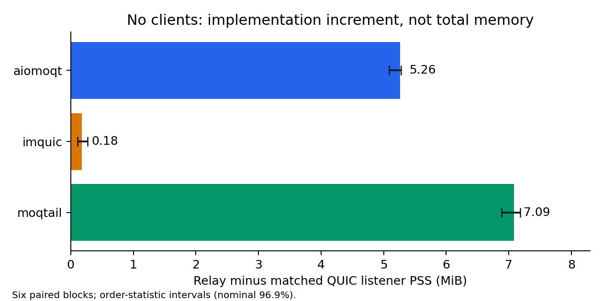
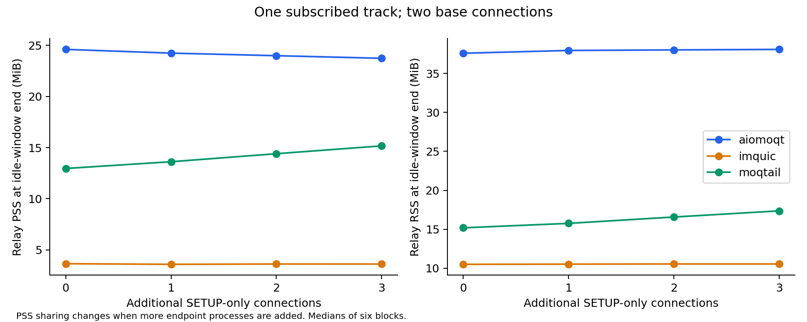
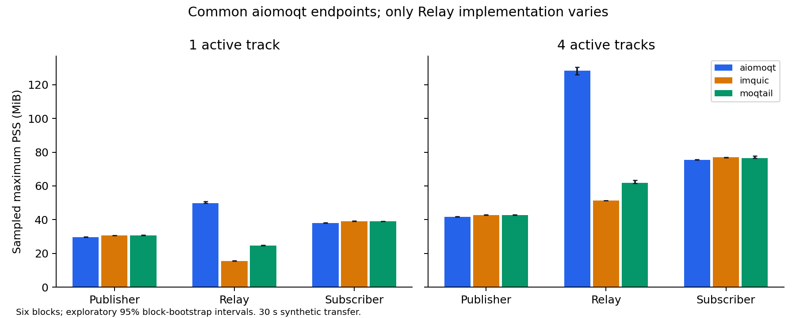
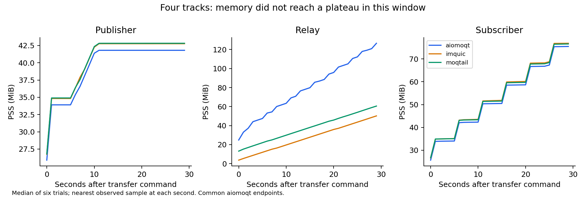
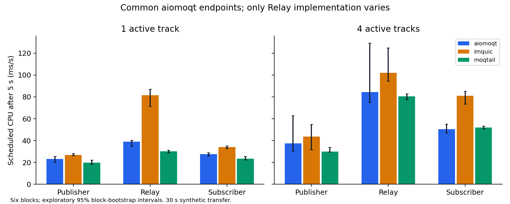
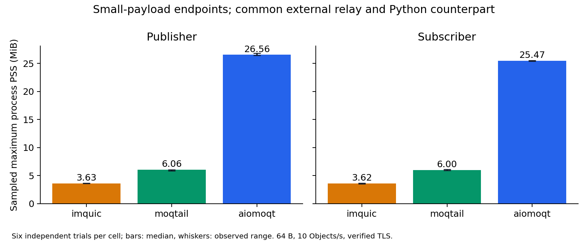

# What does a small MoQT deployment cost to keep running?

Status: English article draft based on the completed measurements.

A small stream still needs processes, encrypted connections and subscription
state. I wanted to measure how much of that resource use remains when there
are few clients—or none—and how much a MoQT relay adds to the QUIC/TLS stack
underneath it.

This is an implementation study of IETF MoQT draft-22 over raw QUIC on one
Linux host. It measures aiomoqt, imquic and MOQtail, with Publisher,
Subscriber and Relay in separate processes. It does not establish a universal
minimum for MoQT or determine whether MoQT fits on a microcontroller.

## Three meanings of cost

- Resident cost: memory and scheduled CPU time while a process waits, with
  no clients or with established sessions.
- Initial cost: the connection, application setup and subscription work
  needed before useful data arrives.
- Incremental cost: the change when another connection, subscription or
  active track is added to a specified starting configuration.

Calling these all “fixed overhead” would obscure important differences.
A relay's total memory is also different from its excess over a QUIC-only
control. I report both the measurement context and the baseline used.

## What was measured

The main relay candidates are aiomoqt 0.14.1, imquic at
[`d93d181`](https://github.com/meetecho/imquic/commit/d93d18141b0db5f167290a6b162b059dc964015e),
and MOQtail relay 0.17.0 at
[`2c3efc6`](https://github.com/moqtail/moqtail/commit/2c3efc60659fec3dfda5ded56581236a4035e8f1).
Publisher and Subscriber use aiomoqt 0.14.1 with aiopquic 0.7.1 throughout
the relay comparisons. The [qualification record](../../experiments/records/2026-11-20-draft22-qualification.md)
contains dependencies, admission checks and unsuccessful setup attempts.

The experiments run native processes on Linux x86_64 over private IPv4
loopback network namespaces, with validated test certificates. Codec and
camera work are absent: Objects contain synthetic payloads. This isolates
transport/application state better, but does not reproduce a real Wi-Fi or
wide-area media deployment.

Memory uses proportional set size (PSS), with resident set size (RSS) as a
secondary measure. PSS apportions shared mappings among processes. A lower
per-process PSS after adding processes does not necessarily mean less
allocated application state. Earlier CPU measurements sum scheduled runtime across a stable observed
thread set. The final sustained series uses a Linux process CPU clock,
which retains runtime from threads that have exited; the reason for this
change is recorded below. In either case, 10 ms/s means approximately 1%
of one CPU core.
These counters omit kernel network memory and do not estimate energy.

Each comparison starts fresh processes, balances run order and retains
unsuccessful trials. Earlier pilots and later follow-ups remain separate.
A repeated sample within one process is not an independent experiment.

## What a relay adds before the first client

Each relay was compared with a minimal listener using the same QUIC/TLS
stack. The five-second, zero-connection follow-up found these median paired
PSS differences:

- aiomoqt: 5.26 MiB, interval 5.08–5.28 MiB.
- imquic: 0.18 MiB, interval 0.11–0.27 MiB.
- MOQtail: 7.09 MiB, interval 6.89–7.18 MiB.

For context, the zero-client relay processes themselves had median PSS
of 27.67 MiB (aiomoqt), 3.06 MiB (imquic) and 9.89 MiB (MOQtail). Their
controls had medians of 22.41, 2.87 and 2.83 MiB respectively. These are
separately computed absolute medians; subtracting them is not the same
operation as taking the median of paired differences.

These are six-pair order-statistic intervals with nominal 96.9% coverage
under the stated independence assumptions. They are differences between the
tested programs, including initialization, optional features and build
choices. They are not the total memory needed to run a relay and do not
isolate the MoQT specification's intrinsic cost.

The median idle CPU differences were small. For aiomoqt, however, the
interval still extended to +1.16 ms/s, so this run did not resolve a
+1 ms/s increase. A measured zero for another implementation likewise does
not prove literally zero execution.

[Data and methods](../../experiments/records/2026-11-20-idle-follow-up.md).

## Connection setup is a separate cost

Across twelve paired one-connection blocks per implementation, median
client-observed MoQT SETUP time after the QUIC connection call returned was
1.72 ms for aiomoqt, 0.50 ms for imquic and 1.26 ms for MOQtail. These are
local application-call intervals, not Internet startup predictions or the
entire TLS handshake duration. The available startup data do not resolve
handshake CPU or short-lived allocation peaks.

UDP-byte differences cover the whole captured handshake/application/ACK
exchange through the observation window. They must not be labeled as the
encoded SETUP message size: QUIC packetization and ACK scheduling can vary,
and an imquic interval even crosses zero.

## Idle subscriptions do not imply a constant slope

With one Publisher connection and one Subscriber connection, the idle pilot
varied distinct subscribed tracks from zero to four. Median Relay PSS
changes at four subscriptions were 104 KiB for aiomoqt, 154 KiB for imquic
and 398 KiB for MOQtail. The corresponding zero-subscription drift was
between -1 and +1 KiB in the Relay observations.

The endpoints also acquired state. At four subscriptions, median Publisher
changes were 44–48 KiB across relay arms; Subscriber changes were
44–63.5 KiB. A few Subscriber observations were near 2 MiB and remain in
the data. The same Python endpoints appear in every arm.

The imquic and MOQtail relay medians were not monotonic across levels.
These small, short-window observations do not support a universal
“bytes per subscription” estimate. They include distinct-track and
subscription bookkeeping together.

[Idle subscription pilot](../../experiments/records/2026-11-21-idle-subscriptions.md).

## Separating extra connections from extra tracks

With one acknowledged track subscription, the new idle series added zero
to three SETUP-only clients. All 72 trials completed. At three extra clients,
median within-block Relay PSS differences from the base case were
-1,010 KiB for aiomoqt, -29 KiB for imquic and +2,225 KiB for MOQtail.

The negative values need care: aiomoqt's separate RSS medians rose from
about 37.58 to 38.07 MiB while its PSS medians fell. Adding Python endpoint
processes changes the sharing denominator for common mappings. This is
consistent with PSS redistribution, not evidence that connections free
application state. The measurements do not isolate private allocations.

## Publisher, Subscriber and Relay during sustained transfer

All 36 replacement trials delivered the expected data: 1,500 Objects per
track, 8 KiB per Object, one or four tracks, at 20 ms intervals. Streams and
subscriptions remain open until receipt is verified. Six blocks balance
all relay orders at each level.

The median sampled maximum PSS values for Publisher / Relay / Subscriber
were:

- One track:
  - aiomoqt Relay: 29.68 / 49.76 / 38.03 MiB.
  - imquic Relay: 30.64 / 15.64 / 39.16 MiB.
  - MOQtail Relay: 30.82 / 24.81 / 39.05 MiB.
- Four tracks:
  - aiomoqt Relay: 41.81 / 128.24 / 75.51 MiB.
  - imquic Relay: 42.76 / 51.40 / 76.88 MiB.
  - MOQtail Relay: 42.82 / 61.79 / 76.60 MiB.

These are **finite-window maxima, not steady-state memory requirements**.
From the first sample after five seconds to the final sample, median Relay
PSS increased by about 80.66 MiB (aiomoqt), 39.50 MiB (imquic) and 39.74 MiB
(MOQtail) in the four-track case. The Subscribers also grew by roughly
41–42 MiB, while Publisher curves largely flattened after the initial
allocation steps. A longer observation exposed growth that the short pilot could not reveal.

Source inspection provides concrete reasons to investigate retention:
aiomoqt's sample relay enables a recent-object cache (32 MiB per track,
256 MiB relay-wide), and the tested imquic demo duplicates incoming Objects
into a track list for later FETCH. Those behaviors are implementation
features, not a fixed protocol requirement. Endpoint retention and the
complete breakdown of native versus Python allocations require separate
attribution; the measured growth alone does not establish a memory leak. No active
QUIC-only or cache-disabled control was measured, so the added active
footprint cannot be assigned entirely to MoQT.

[Memory investigation and its limits](../../experiments/records/2026-11-22-memory-growth.md).

CPU after the first five seconds is reported as a time-window average,
not proof of equilibrium. The block diagnostics also show changes between
the first and last three blocks; small CPU differences should not be read
as stable rankings. The intervals are exploratory, not simultaneous
guarantees across every comparison. At four tracks the median Publisher / Relay /
Subscriber values were 37.44 / 84.53 / 50.30 ms/s through aiomoqt,
43.67 / 101.92 / 80.96 ms/s through imquic, and
29.98 / 80.44 / 51.94 ms/s through MOQtail.

The endpoints are the same Python programs in every arm. The result is a
comparison of relay/endpoints together, not a ranking of Publisher or
Subscriber libraries. Four tracks also quadruple aggregate payload rate;
these differences cannot isolate subscription bookkeeping alone.

[Conditions, observations and exploratory intervals](../../experiments/records/2026-11-22-resource-series.md).

## A counter failure changed the measurement

The first sustained-transfer attempt used the same per-thread scheduled
runtime method as the earlier short pilots. MOQtail changed its thread set
about nine seconds into transfer. Summing only live threads would lose
runtime from an exited thread, so the affected CPU rows were invalidated.

I stopped that attempt after nine completed trials, retained its data and
switched to a Linux process CPU clock. A check with an 80 ms worker retained
its runtime after the worker exited. The replacement series keeps the same
payloads, pacing, run order and observation windows. Only its CPU counter
changes. The completed idle series remains separate; its two invalid CPU
rows belong to extra idle clients and are excluded from CPU estimates.

## A delivery failure changed the comparison

The original finite-stream pilot completed all transfers for aiomoqt and
MOQtail, but only 4 of 24 imquic trials delivered every Object to every
Subscriber. Missing deliveries were always the final Object. Separate
investigation identified track removal on PUBLISH_DONE before later stream
data was processed in the tested relay example; changing terminal-message
timing affected the reproduction.

The sustained-transfer series verifies receipt before closing streams and
sending PUBLISH_DONE. This measures active transfer with subscriptions kept
open. It does not fix or retest the original termination behavior, and its
success rate must not replace the earlier failed trials.

[Original pilot](../../experiments/records/2026-11-20-draft22-fanout-pilot.md)
and [terminal Object investigation](../../experiments/records/2026-11-20-imquic-final-object.md).

## What the results can support

The measured implementation and configuration matter. A QUIC-only control
helps distinguish an application's extra resident footprint from the stack
it builds on. Endpoint usage must be counted as well as relay usage: a
small relay does not by itself make the complete application small.

This study cannot turn a desktop process footprint into a microcontroller
RAM requirement. It also cannot rank MoQT against WebRTC, WebSocket or HLS;
those would require separate application and topology definitions.

Remaining follow-up questions include alternative endpoint implementations,
runtime-only controls, kernel socket memory, configuration effects,
session reuse, non-loopback networks and WebTransport. None is silently
assumed to behave like the cases measured here.

## Follow-up: changing the endpoint implementation

The relay comparison held the Python endpoints fixed. A separate
[small-payload endpoint pilot](../../experiments/records/2026-11-22-endpoint-resources.md)
now changes Publisher and Subscriber implementations independently, using
imquic, MOQtail and aiomoqt with a common external relay and counterpart.
All 36 balanced trials delivered 50 verified 64-byte Objects with
certificate verification enabled.

Sampled maximum process-PSS medians for Publisher / Subscriber were
3.63 / 3.62 MiB for imquic, 6.06 / 6.00 MiB for MOQtail, and
26.56 / 25.47 MiB for aiomoqt. This is a different, much smaller workload
than the earlier sustained-transfer series; the two tables are not a
before/after optimization experiment.

A separate balanced series repeated the anonymous/file-backed PSS
measurement six times per implementation and role. Total-memory and anonymous-memory rankings differ, and CPU does not
follow the memory ranking. These observations show implementation choices
matter, without establishing a firmware RAM budget or an intrinsic MoQT
minimum. The linked report records the adapters, unrelated-root negative
checks, candidate exclusions and all data.

## Reproduce and inspect the observations

- [Experiment plan](../../experiment-plan.md).
- [Matched idle controls](../../experiments/idle/README.md).
- [Idle and startup follow-up](../../experiments/idle/FOLLOW-UP.md).
- [Finite-stream pilot](../../experiments/fanout/README.md).
- [Sustained resource follow-up](../../experiments/resources/README.md).

The repository records failed experiments and changes to the harness as
well as the final observations. Synthetic payloads are used throughout;
private keys, credentials and packet capture originals are excluded from
published records.
